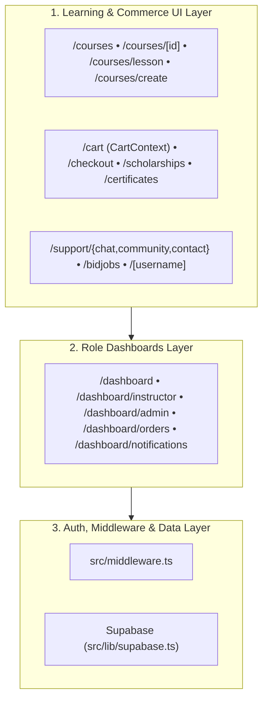

# Faireer (`faireer`) — EdTech Course Marketplace, Scholarships & Career Ecosystem

A full-stack Next.js and Supabase online learning marketplace (`fairer-app`) combining self-paced courses, instructor dashboards, verified certificates, scholarships, community support, and an integrated `bidjobs` career bridge.

---

## 1. Executive Summary & Purpose
`faireer` connects learners, instructors, and scholarship sponsors on a single platform. Students discover courses (`/courses`, `/search`), manage carts and checkout (`/cart`, `/checkout`), earn certificates (`/certificates`), and transition into work opportunities (`/bidjobs`), while instructors and admins manage content and orders from `/dashboard`.

---

## 2. System Architecture & Layers



| Layer | Responsibility | Key Files |
| :--- | :--- | :--- |
| **Learning Experience Layer** | Course discovery, course creation, lesson player, public `[username]` portfolios, and certificates | `src/app/courses/{page,[id],lesson,create}/page.tsx`, `src/app/{certificates,scholarships,[username]}/page.tsx` |
| **E-Commerce & Cart Layer** | Persistent shopping cart state (`CartContext.tsx`) and checkout pipeline | `src/context/CartContext.tsx`, `src/app/{cart,checkout}/page.tsx` |
| **Multi-Role Dashboards** | Student, Instructor, and Admin dashboards with order & notification tracking | `src/app/dashboard/{page,instructor,admin,orders,notifications}/page.tsx` |
| **Support & Career Bridge** | Live chat, community forums, contact support, and BidJobs integration | `src/app/support/{page,chat,community,contact}/page.tsx`, `src/app/bidjobs/page.tsx` |
| **Middleware & Persistence Layer** | Session routing and Supabase client integration | `src/middleware.ts`, `src/lib/supabase.ts`, `src/lib/utils.ts` |

---

## 3. Core Functionality & Modules
- **Course Marketplace (`/courses`, `/courses/[id]`, `/courses/lesson`)**: Browse, purchase, and complete structured video/text lessons.
- **Instructor Studio (`/courses/create`, `/dashboard/instructor`)**: Publish courses and track enrollments.
- **Scholarships & Certificates (`/scholarships`, `/certificates`)**: Expand access through sponsored seats and verifiable completion credentials.
- **E-Commerce Flow (`/cart`, `/checkout`, `/dashboard/orders`)**: Full cart-to-order lifecycle.
- **Community & Support (`/support/chat`, `/support/community`)**: Peer discussion and helpdesk channels.

---

## 4. Project Structure
```text
├── src/
│   ├── app/
│   │   ├── courses/      # Catalog, [id], lesson player, course creator
│   │   ├── dashboard/    # Student, instructor, admin, orders, notifications
│   │   ├── support/      # chat, community, contact
│   │   ├── cart/, checkout/, certificates/, scholarships/, bidjobs/
│   │   ├── login/, signup/, profile/, settings/, search/, [username]/
│   ├── components/       # Header, HeaderWrapper
│   ├── context/          # CartContext
│   ├── lib/              # supabase.ts, utils.ts
│   └── middleware.ts
└── public/
```

---

## 5. Getting Started

```bash
git clone https://github.com/islamsamyy/faireer.git
cd faireer
npm install
npm run dev
```

---

## 6. Business Value & Growth Opportunities
- **Learn-to-Earn Ecosystem**: Linking `/certificates` directly to `/bidjobs` creates a high-retention loop where graduates immediately monetize newly learned skills.
- **B2B Corporate Training & NGO Scholarships**: Use `/scholarships` to sell bulk seat sponsorships to NGOs, universities, and corporate L&D departments.
- **Instructor Revenue Share**: Take a marketplace commission on course sales while offering instructors built-in audience distribution.
