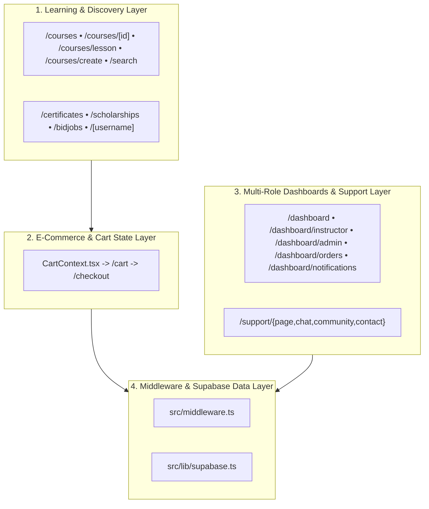

# Faireer (`faireer`) — EdTech Course Marketplace, Scholarships & Career Bridge

<p align="center">
  
</p>

## Table of Contents
- [Executive Summary & Business Utility](#executive-summary--business-utility)
- [Visual Showcase (UI & Dashboards)](#visual-showcase-ui--dashboards)
- [System Architecture & Layers](#system-architecture--layers)
- [Data Model & Learning Flows](#data-model--learning-flows)
- [Application Modules & Workflows](#application-modules--workflows)
- [Getting Started & Scripts](#getting-started--scripts)
- [Business Value, ROI & Growth Opportunities](#business-value-roi--growth-opportunities)

---

## Executive Summary & Business Utility
`faireer` (`fairer-app`) is a full-stack Next.js and Supabase EdTech marketplace designed to connect learners, instructors, and scholarship sponsors. Beyond standard course sales (`/courses`, `/cart`, `/checkout`), it closes the loop between education and employment through verifiable certificates (`/certificates`), sponsored scholarships (`/scholarships`), community support (`/support/chat`, `/support/community`), and a direct `/bidjobs` career bridge.

---

## Visual Showcase (UI & Dashboards)
Hero and branding visuals stored in `public/`:

| Platform Hero Visual | Brand Identity |
| :---: | :---: |
|  |  |

---

## System Architecture & Layers



| Layer | Responsibility | Key Files |
| :--- | :--- | :--- |
| **Learning Experience Layer** | Course catalog, creation wizard, lesson player, certificates, scholarships, and public `[username]` profiles | `src/app/courses/*`, `src/app/{certificates,scholarships,bidjobs,[username]}/page.tsx` |
| **Commerce & Cart Layer** | Client shopping cart state (`CartContext.tsx`) and checkout pipeline | `src/context/CartContext.tsx`, `src/app/{cart,checkout}/page.tsx` |
| **Multi-Role Operations Layer** | Student, Instructor, and Admin dashboards with order and notification views | `src/app/dashboard/{page,instructor,admin,orders,notifications}/page.tsx` |
| **Support & Community Layer** | Live support chat, community forums, and contact forms | `src/app/support/{page,chat,community,contact}/page.tsx` |
| **Auth & Persistence Layer** | Request middleware and Supabase client | `src/middleware.ts`, `src/lib/supabase.ts`, `src/components/Header.tsx` |

---

## Data Model & Learning Flows
- **Student Flow**: Discover (`/courses`, `/search`) -> Add to Cart (`CartContext`) -> Checkout (`/checkout`) -> Learn (`/courses/lesson`) -> Certify (`/certificates`) -> Apply for Work (`/bidjobs`).
- **Instructor Flow**: Create Course (`/courses/create`) -> Track Sales & Enrollments (`/dashboard/instructor`, `/dashboard/orders`).

---

## Application Modules & Workflows
- **Courses**: `/courses`, `/courses/[id]`, `/courses/lesson`, `/courses/create`
- **Commerce**: `/cart`, `/checkout`, `/dashboard/orders`
- **Dashboards**: `/dashboard`, `/dashboard/instructor`, `/dashboard/admin`, `/dashboard/notifications`
- **Auth & Profiles**: `/login`, `/signup`, `/profile`, `/settings`, `/[username]`
- **Support & Career**: `/support`, `/support/chat`, `/support/community`, `/support/contact`, `/scholarships`, `/certificates`, `/bidjobs`

---

## Getting Started & Scripts

```bash
git clone https://github.com/islamsamyy/faireer.git
cd faireer
npm install
npm run dev
```

---

## Business Value, ROI & Growth Opportunities
- **Learn-to-Earn Retention**: Connecting `/certificates` to `/bidjobs` increases course completion rates and platform stickiness.
- **Sponsored Seat Revenue (`/scholarships`)**: Sell bulk scholarship cohorts to NGOs, universities, and corporate CSR programs.
- **Creator Marketplace Economics**: Take a platform commission on instructor-created courses while offering zero-setup hosting and student support.
